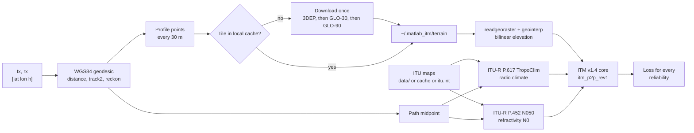
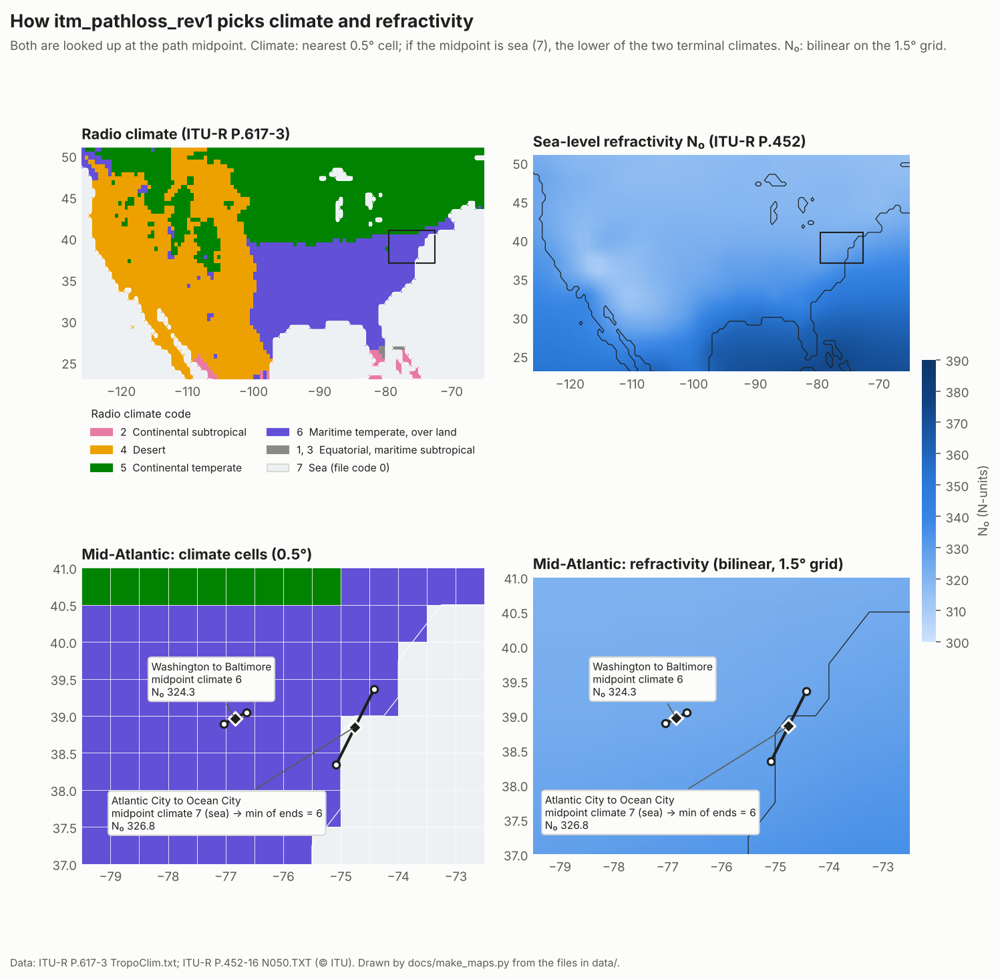
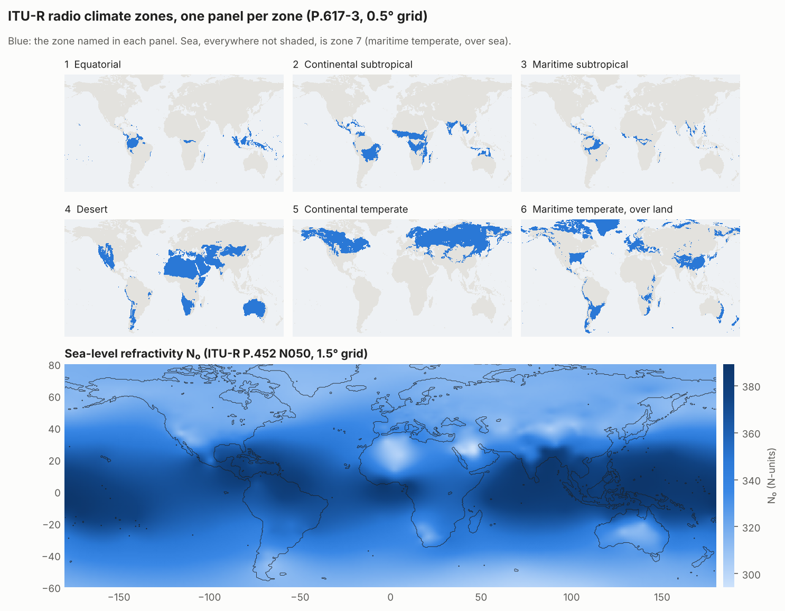

# matlab_itm

A MATLAB port of the NTIA/ITS Irregular Terrain Model (ITM, Longley-Rice)
version 1.4, point-to-point mode, with automatic terrain, radio climate, and
refractivity. It runs in MATLAB R2025b and in apps compiled with MATLAB
Compiler for the free MATLAB Runtime.

The core is a line-by-line port of the C++ reference implementation at
[NTIA/itm](https://github.com/NTIA/itm) (commit `183ad95`). It matches that
code to within 4 × 10⁻¹³ dB on 740 test cases, with identical propagation
modes, warning flags, and intermediate values.

## Get started

### What you need

- MATLAB R2025b (the release this is tested on) with Mapping Toolbox.
- Internet access the first time you compute a path, to download terrain
  tiles. After that, paths in the same area run from a local cache.
- Access to this repository. It's private because it contains ITU digital
  maps that ITU doesn't allow anyone to redistribute; ask the owner to add you.

### Download and check the install

1. Get the code, either way:
   - With git: `git clone https://github.com/nicklasorte/matlab_itm.git`
   - Without git: on the repository page, click **Code** > **Download ZIP**,
     then unzip it.
1. In MATLAB, go to the folder and add it to the path:

   ```matlab
   cd matlab_itm
   addpath(pwd)
   savepath          % optional: keep it on the path in later sessions
   ```

1. Run the self-test. It takes about 5 seconds and should end with `PASSED`:

   ```matlab
   itm_app_rev1("--selftest")              % add "--offline" to skip downloads
   ```

   For a window with a button instead, run `itm_app_rev1`.

### Compute a path

```matlab
tx = [38.8895, -77.0353, 30];        % [lat (deg), lon (deg), height above ground (m)]
rx = [39.0458, -76.6413, 10];
reliability = [1 10 50 90 99];       % time percentages

loss_db = itm_pathloss_rev1(tx, rx, 2700, reliability)
% loss_db = 178.61  181.90  184.56  186.89  188.79
```

That's all you pass. The function finds the terrain profile, the radio
climate, and the surface refractivity for the path, and evaluates every
reliability from one geometry pass.

Many transmitters to one receiver, in one call:

```matlab
txs = [38.90 -77.03 30; 38.95 -76.90 25; 39.20 -76.70 40];
L = itm_pathloss_rev1(txs, rx, 2700, reliability);    % 3-by-5
```

A reliability-by-confidence table:

```matlab
T = itm_pathloss_rev1(tx, rx, 2700, [10; 50; 90], confidence=[10 50 90]);   % 3-by-3
```

### Elevation angles at the transmitter and receiver

The third output is the elevation angle of the path at each end, in
degrees, positive up, one row per link:

```matlab
[loss_db, info, elev_deg] = itm_pathloss_rev1(tx, rx, 2700, 50);
elev_deg            % [TX, RX] in degrees
info.profile.azimuth_deg    % azimuth from TX to RX, degrees from north
```

On a line-of-sight path the angle points at the other antenna; otherwise
it points at the terrain horizon (the obstacle that sets the radio
horizon). Both use ITM's effective earth, so they include standard
refraction. This is the angle to use for antenna gain toward the path.
`itm_p2p_rev1` returns the same values in `info.elevation_deg`.

Note: `info.theta_hzn_rad` is ITM's internal horizon angle. On paths well
within line of sight, ITM replaces it with a smooth-earth estimate, so it's
not the geometric angle. Use `elevation_deg`.

### Replace the SEADLib mechanism

If you call ITM through `ITMP2P_mechanism_rev4_embed_height` (SEADLib.dll)
in [general_terrestrial_pathloss](https://github.com/nicklasorte/general_terrestrial_pathloss),
`itm_p2p_mechanism_rev1` takes the same inputs, without the app handle and
the parallel flag, and returns the same outputs:

```matlab
% Before: [dBloss, prop_mode] = ITMP2P_mechanism_rev4_embed_height(app, bs, sim_pt, reliability, confidence, FreqMHz, Tpol, parallel_flag);
[dBloss, prop_mode, elev_deg] = itm_p2p_mechanism_rev1(bs, sim_pt, reliability, confidence, FreqMHz, Tpol);
```

It needs no .NET assembly, no `C:\USGS` terrain folder, and no
`TropoClim.mat` or `data_N050.mat`. It uses the same defaults (ε 25,
σ 0.02 S/m, mdvar 13), the same climate rule (the lower of the two terminal
climates), N₀ at the path midpoint, and the same `prop_mode` codes (0 line
of sight, 5 and 6 single horizon, 9 and 10 double horizon, from ITM 1.2.2).
On the Salt Lake City test link in `test_itm_utah_rev1.m`, SEADLib returns
122.49 dB and line of sight; this returns 122.51 dB and line of sight.

What's different, by design:

- **Failures are loud.** SEADLib errors became 1000 dB, climate errors
  became climate 5, refractivity errors became 301 N-units, and infinite
  losses became 1 or 999 dB, all silently. Here a failure raises an error
  that names the link. With `OnError="nan"`, a failed link gets `NaN`, and
  the fourth output says why.
- **ITM v1.4**, NTIA's current release, instead of the ITM 1.2.2 inside
  SEADLib, and USGS 3DEP 1" terrain at 30 m spacing instead of the
  `C:\USGS` tiles. Expect small differences. Only one SEADLib result has
  been compared so far (0.02 dB apart); terrain differences can matter more
  on paths that graze a ridge.

### Propagation mode

The fourth output of `itm_pathloss_rev1` is the propagation mode of each
link in the ITM 1.2.2 codes that SEADLib returns: 0 line of sight, 5
single-horizon diffraction, 6 single-horizon troposcatter, 9 double-horizon
diffraction, 10 double-horizon troposcatter. `info.mode` holds the ITM v1.4
mode (1 line of sight, 2 diffraction, 3 troposcatter).

### Run MathWorks' Longley-Rice on the same terrain

`itm_matlab_lr_rev1` runs MATLAB's `propagationModel("longley-rice")`
(Antenna Toolbox or Communications Toolbox) with the same inputs, defaults,
climate, N₀, and USGS 1" terrain as `itm_pathloss_rev1`, instead of MATLAB's
built-in GMTED2010 terrain (about 250 m):

```matlab
itm_matlab_terrain_rev1(region=[36 42 -83 -74]);    % once per study area
L_mw  = itm_matlab_lr_rev1(tx, rx, 2700, [1 50 99]);
L_itm = itm_pathloss_rev1(tx, rx, 2700, [1 50 99]);
```

MATLAB's terrain models read custom terrain only as DTED, so
`itm_matlab_terrain_rev1` writes the tiles as DTED level 2
(`itm_dted_tiles_rev1`, 1.3 s and 26 MB per tile) and registers them as the
custom terrain `"itm_usgs1"`. Registering takes about 30 s per tile, but
MATLAB keeps it across sessions, so it's a one-time cost per area. Pass
`Map="itm_usgs1"` to `pathloss`, `coverage`, or `siteviewer` to use it
anywhere. DTED stores whole meters, so heights are rounded to 1 m, and
level 2 has 1" spacing only below 50° latitude.

### Run it without MATLAB

Compile the self-test app or the command-line tool and run it on any
computer with the free MATLAB Runtime. See
[Compile for MATLAB Runtime](#compile-for-matlab-runtime).

## Limits: the model fails loudly

Inputs outside ITM's range stop the calculation with an error that says
what's wrong and how to proceed. Nothing outside the range returns a number
silently.

| Input | Range | Outside the range |
| --- | --- | --- |
| Path length | 1 to 2000 km | Error `itm:validity:Distance` (names the links in a batch) |
| Frequency | 20 to 20000 MHz | Error `itm:InvalidFrequency` |
| Terminal height above ground | 0.5 to 3000 m | Error `itm:InvalidTxHeight`, `itm:InvalidRxHeight` |
| Reliability, confidence | Between 0 and 100 %, exclusive | Error `itm:InvalidReliability`, `itm:InvalidConfidence` |
| Sea-level refractivity N₀ | 250 to 400 N-units | Error `itm:InvalidRefractivity` |
| Terrain | Every land point needs a terrain tile | Error `itm:terrain:NoCoverage` |

Inside the range, inputs near a limit raise one MATLAB warning per call,
`itm:validity:Caution`, that names the condition and the links: frequency
outside 40 to 10000 MHz, terminal heights outside 1 to 1000 m, paths over
1000 km, and percentages far in a tail (below about 0.1 % or above 99.9 %).
NTIA's horizon-geometry flags are common on real terrain, so they're kept in
`info.warnings` without a MATLAB warning.

To compute outside the range anyway, pass `validity="warn"` (errors for
distance become warnings) or `validity="off"` (no checks beyond NTIA's hard
limits, the C++ behavior). In a batch, an error names the failing link, for
example `Link 2: ITM error 1001: RX terminal height must be 0.5 to 3000 m.`

## Functions

| Function | Purpose |
| --- | --- |
| `itm_pathloss_rev1(tx, rx, f_mhz, reliability)` | Path loss between locations, with everything automatic. Accepts N links. Also returns elevation angles. |
| `itm_p2p_mechanism_rev1(bs, sim_pt, reliability, confidence, FreqMHz, Tpol)` | Drop-in replacement for the SEADLib `ITMP2P_mechanism_rev4_embed_height`. |
| `itm_matlab_lr_rev1(tx, rx, f_mhz, reliability)` | MathWorks' `propagationModel("longley-rice")` on this repository's USGS 1" terrain. |
| `itm_matlab_terrain_rev1(region=[...])` | Registers USGS 1" terrain (as DTED) with MATLAB's terrain models, once per area. |
| `itm_dted_tiles_rev1(tile_lat, tile_lon)` | Writes USGS 1" tiles as DTED level 2. |
| `itm_p2p_rev1(h_tx_m, h_rx_m, pfl, f_mhz, reliability)` | ITM core for a terrain profile you supply. Equivalent to NTIA `ITM_P2P_CR` (and `ITM_P2P_TLS` with the `location` option). |
| `itm_terrain_profile_rev1(lat1, lon1, lat2, lon2)` | ITM PFL profile(s) along the WGS84 geodesic. |
| `itm_terrain_elevation_rev1(lat, lon)` | Terrain elevation at points, from cached DEM tiles. |
| `itm_radio_climate_rev1(lat, lon)` | ITU-R P.617 radio climate code (1–7). |
| `itm_surface_refractivity_rev1(lat, lon)` | ITU-R P.452 sea-level refractivity N₀. |
| `itm_setup_rev1(region=[lat_min lat_max lon_min lon_max])` | Cache the ITU maps and the terrain tiles for an area (offline servers, shared caches). |
| `itm_app_rev1()` | Self-test app: a **Run self-test** button, a PASSED/FAILED status box, and a table of checks. `itm_app_rev1("--selftest")` runs headless. |
| `itm_selftest_rev1()` | The self-test the app runs. Deployable (no `matlab.unittest`). |
| `itm_cli_rev1(...)` | Command-line path-loss tool for a compiled app. |
| `build_itm_app_rev1()` | Compiles the app (or the CLI) with MATLAB Compiler, with every data file it needs. |

Every function documents its inputs and name-value options; run
`help itm_pathloss_rev1`.

## How a call flows



## Terrain data

The terrain source has to work in a compiled app, without a MATLAB license
or an account. All sources here are public, keyless, and served as plain
GeoTIFF files over HTTPS, so the app needs only `websave` and
`readgeoraster`, which MATLAB Compiler supports.

| Source | Coverage | Resolution | Surface | Vertical datum | Tile size |
| --- | --- | --- | --- | --- | --- |
| [USGS 3DEP 1 arc-second](https://www.usgs.gov/3d-elevation-program) (default) | U.S. (CONUS, Alaska, Hawaii), Puerto Rico, U.S. Virgin Islands, Guam, border areas of Canada and Mexico | ~30 m | Bare earth | NAVD88 | ~45 MB per 1° × 1° |
| [Copernicus GLO-30](https://registry.opendata.aws/copernicus-dem/) (fallback) | Global | ~30 m | Surface model (includes buildings and canopy) | EGM2008 | ~35 MB per 1° × 1° |
| [Copernicus GLO-90](https://registry.opendata.aws/copernicus-dem/) (second fallback) | Global, including tiles not released in GLO-30 | ~90 m | Surface model | EGM2008 | ~5 MB per 1° × 1° |
| USGS 3DEP 1/3 arc-second (`terrain_source="usgs3dep13"`, opt-in) | CONUS, Hawaii, territories | ~10 m | Bare earth | NAVD88 | ~370 MB per 1° × 1° |

With `terrain_source="auto"` (the default), each point comes from 3DEP.
Points where 3DEP has no tile or no data (outside the U.S., past a border,
offshore) are filled from GLO-30, then GLO-90. Points with no data in any
source are set to 0 m when they're water: no-data cells inside a tile
(coasts), or sea on the ITU-R P.617 map. A land point that no chosen source
covers raises `itm:terrain:NoCoverage`, so forcing `terrain_source="usgs3dep"`
outside the U.S. fails loudly instead of reading land as sea level.
`info.profile.source_code` records the source of every point.

For 10 m terrain, pass `terrain_source="usgs3dep13", spacing_m=10`. Its
tiles are large, so it's never part of `"auto"`.

Tiles download the first time a path needs them and are reused afterward:

- **Cache folder.** `<cache>/terrain`, where `<cache>` is the
  `MATLAB_ITM_CACHE` environment variable, else `%LOCALAPPDATA%\matlab_itm`
  on Windows, else `~/.matlab_itm`. `MATLAB_ITM_TERRAIN_DIR` or the
  `terrain_dir` option overrides the terrain folder alone.
- **Shared with itu_p2001.** Both tools use the providers' file names, so
  a tile already in the itu_p2001 cache (`ITU_P2001_CACHE`, else
  `~/.itu_p2001/dem/...`) is read in place, not downloaded again. Set
  `MATLAB_ITM_SHARE_P2001_CACHE=0` to turn this off.
- **Decoded tiles on disk.** Decoding a GeoTIFF takes about 170 ms. The
  decoded grid is saved beside it (`.zcache`, about 52 MB per tile), so a new
  MATLAB or app process loads a tile in about 10 ms.
- **Memory.** Decoded tiles stay in memory up to 2 GB (about 38 one-arc-second
  tiles); set `MATLAB_ITM_TILE_CACHE_GB` to change it. The least recently
  used tile is dropped first.
- **Offline servers.** Run `itm_setup_rev1(region=[...])` on a connected
  machine, copy the cache folder, set `MATLAB_ITM_CACHE` to it, and call
  with `download=false`. A missing tile then raises
  `itm:terrain:TileMissing` rather than failing silently.
- **Shared folders.** Downloads go to a temporary file and are renamed into
  place atomically (first writer wins), so several compiled servers can
  share one cache. The test suite checks this with two parallel workers.
- **Ocean tiles.** Copernicus publishes a `tileList.txt` of every tile; it's
  cached once, and a tile absent from it counts as ocean without a request.
  So a network or proxy error is never mistaken for open water. A 3DEP tile
  that returns HTTP 404 is remembered with a zero-byte `.404` marker.

Rough download sizes: a 100 km radius around one site is about 9 tiles
(400 MB); all of CONUS 3DEP is about 1,000 tiles (45 GB).

## Climate and refractivity

Yes, both are automatic: every call looks them up from the path's latitude
and longitude.



Both come from ITU-R data files (see [data/SOURCES.md](data/SOURCES.md)),
loaded in this order:

1. `MATLAB_ITM_MAPS_DIR`, if set: `itm_maps.mat` or the two ITU text files.
1. `data/TropoClim.txt` and `data/N050.TXT` in this repository.
1. The same files packaged in a compiled app.
1. `<cache>/itu_maps/itm_maps.mat`.
1. A download of the ITU supplement ZIPs, parsed and cached. Set
   `MATLAB_ITM_OFFLINE=1` to forbid it.

ITU forbids reproducing or distributing its digital maps without written
permission. Keep this repository and apps built from it inside your
organization.

- **Radio climate:** ITU-R P.617-3 radio-climatic zone map (`TropoClim.txt`,
  0.5° grid), nearest grid point, at the path midpoint. If the midpoint is
  over sea (code 7), the lower of the two terminal climates is used.
- **Refractivity:** ITU-R P.452 sea-level surface refractivity (`N050.TXT`,
  1.5° grid), bilinear interpolation, at the path midpoint. ITM converts N₀
  to the surface value Nₛ with the profile's mean terrain height.

These rules and the parameter defaults below follow the WInnForum CBRS SAS
reference model (`tropoclim.py`, `refractivity.py`, `wf_itm.py`). The
lookups reproduce that code exactly on 309 global test points.

Note: the ITU-R P.617 map puts Washington, DC, and most of the eastern
U.S. south of about 40.5° N in climate 6 (maritime temperate over land),
not 5 (continental temperate).



To redraw both figures from the data files: `python3 docs/make_maps.py`.

## Defaults

| Parameter | Default | Option |
| --- | --- | --- |
| Confidence | 50 % | `confidence` |
| Polarization | Vertical | `polarization` |
| Relative permittivity | 25 | `epsilon` |
| Conductivity | 0.02 S/m | `sigma` |
| Mode of variability | 13 (broadcast, no location variability) | `mdvar` |
| Profile spacing | 30 m (native DEM resolution) | `spacing_m` |
| Profile point cap | None (WInnForum uses 1501) | `max_points` |
| Radio climate rule | Midpoint, or the lower terminal climate if the midpoint is over sea (WInnForum) | `climate_rule="endpoints"`: the lower terminal climate (SEADLib mechanism) |

Reliability and confidence are percentages (0 to 100, exclusive), as in the
NTIA code. The WInnForum Python wrapper uses fractions (0 to 1).

## Vectorization

- **Reliability and confidence.** The link geometry (horizons, effective
  heights, terrain irregularity, reference attenuation) is computed once.
  Only the variability step runs per percentage, as array math with
  implicit expansion. 1,000 reliabilities cost about the same as one.
- **Terrain.** Horizon search, least-squares fits, and elevation sampling
  are vectorized. Elevations for all links in a call are sampled in one pass
  over the tiles.
- **Lookups.** Climate and refractivity accept arrays of points.
- **Floating point.** Where the C++ accumulates by repeated addition and then
  truncates to an integer index, the MATLAB uses `cumsum`, which adds in the
  same order. A `k*xi` form rounds differently and changed 22 of 740 results
  by up to 0.44 dB in testing.
- **One remaining loop.** The terrain-irregularity resampling keeps a loop of
  at most 245 steps: each step's rounding depends on the previous position,
  so it can't be expressed as an array operation without changing results.
- **Geodesics.** One `distance` call and one `reckon` call per link cover
  every profile point and the midpoint (the same points as `track2`, to
  2 × 10⁻¹² degrees). One call per link, not one for all links, because
  MATLAB's geodesic routines iterate until every element of the array
  converges, so a shared call would make a link's result depend on the other
  links in the batch. The WGS84 ellipsoid object is built once.
- **Interpolation.** One `griddedInterpolant` per tile, queried in intrinsic
  coordinates: the same values as `geointerp` to single-precision rounding
  (rarely 1 ulp, about 10⁻⁵ m, apart) and about 25 times faster.
- **Per-link overhead.** `itm_pathloss_rev1` validates its inputs once, then
  calls the private core for each link without re-running the `arguments`
  block (about 0.4 ms per call).

Measured on R2025b, Apple silicon, before these optimizations
(`tests/benchmark_itm_rev1.m`): a cold first call took 1.2 s (0.4 s parsing
the ITU text files, 0.6 s decoding three tiles), one warm link took 33 ms,
and 50 links × 1,000 reliabilities took 79 ms.

## Time per link

Measured on R2025b, Apple silicon (MacBook Air), one 38 km link
(Washington to Baltimore, 1,278 profile points at 30 m, 2700 MHz), tiles
already downloaded. Run `tests/profile_one_link_rev1.m` to reproduce.

| Stage | Warm (tiles in memory) | Cold (new process) |
| --- | --- | --- |
| Geodesic: `distance` + `reckon` for the profile points | 3.2 ms | |
| Terrain: elevation at the profile points (3 tiles) | 2.4 ms | 70 ms (decoded tiles read from disk) |
| Climate and N₀ lookups | 0.8 ms | 11 ms (ITU maps loaded) |
| ITM core (`itm_p2p_rev1`) | 2.3 ms | |
| **Full call (`itm_pathloss_rev1`)** | **8.8 to 12 ms** | 120 to 450 ms (includes MATLAB compiling the functions on first use) |

The warm full call took 33 ms before the optimizations in this repository.
About 60% of it is now terrain: the WGS84 geodesic (`distance`, `reckon`)
is the largest single piece. The ITM core is about 25%, and the number of
reliabilities barely matters: 1,000 reliabilities cost about the same as
one (12.6 ms versus 12.2 ms per link in the same run).

### Compared with ITU-R P.2001 (itu_p2001)

Same link, frequency, and time percentage, each model with its own terrain
handler (`tests/compare_p2001_rev1.m`, same session, back to back, idle
machine). `itu_p2001` has since adopted this repository's decoded-tile
cache and direct intrinsic coordinates (itu_p2001 commit `0a4b762`):

| Model | Cold (new process) | Warm, 1 percentage | Warm, 1,000 percentages | Core model only |
| --- | --- | --- | --- | --- |
| ITM v1.4 (`matlab_itm`) | 122 ms | 12.5 ms | 11.3 ms | 1.9 ms |
| ITU-R P.2001-6, before the port | 832 ms | 14.6 ms | 26.6 ms | 8.0 ms |
| ITU-R P.2001-6, after the port | 259 ms | 13.4 ms | 25.6 ms | 6.8 ms |

- **Terrain dominates both.** The two terrain handlers cost about the same
  per link, so a single percentage costs nearly the same in either model.
- **The models differ in the core.** P.2001 combines many more mechanisms
  per time percentage (ducting, sporadic-E, troposcatter, rain and gas
  fades), so its core costs several times ITM's and grows with the number
  of percentages; ITM's barely does.
- **The port changed no result.** P.2001 losses before and after are
  identical on five test links at seven percentages, and its ITU-R
  validation set still matches to 7 × 10⁻¹³ dB.

### Fidelity to the original release

The optimized code returns the same losses as the first release of this
port (`656996a`): on the same five links (3DEP, 110 km multi-tile, the
coastal sea-rule path, Mount Washington, and the Alps on Copernicus) at
seven reliabilities from 0.1 to 99.9 %, the largest difference is
9 × 10⁻⁹ dB, from interpolation rounding and 10⁻¹² degree geodesic
differences. The 740 NTIA C++ cases still match to 4 × 10⁻¹³ dB. A link
gives the same loss alone or in any batch, bit for bit.

## Compile for MATLAB Runtime

```matlab
build_itm_app_rev1()                       % self-test app: build/app/itm_app
build_itm_app_rev1(installer=true)         % plus an installer that fetches the Runtime
build_itm_app_rev1(entry="cli")            % command-line path-loss tool
```

To run the app on another computer:

1. Build it on the same operating system as the target computer
   (`build_itm_app_rev1(installer=true)` makes an installer).
1. On the target, install the free
   [MATLAB Runtime](https://www.mathworks.com/products/compiler/matlab-runtime.html)
   for R2025b, or run the installer, which downloads it.
1. Copy the build folder (or the installer) to the target and run the app:
   - Windows: `itm_app.exe --selftest`
   - macOS or Linux: `./run_itm_app.sh <runtime_folder> --selftest`, where
     `<runtime_folder>` is where the Runtime is installed, such as
     `/Applications/MATLAB/MATLAB_Runtime/R2025b`.

The app opens a window with a **Run self-test** button. It runs the same
checks as the test suite and shows PASSED or FAILED, with a row per check.
To verify an installation from a script, run it headless; the exit code is
0 on success and 1 on failure:

```text
itm_app --selftest              # all checks, including terrain downloads
itm_app --selftest --offline    # skip the checks that need the network
```

The build packages everything the code opens by name at run time, which
dependency analysis can't find: `data/` (ITU maps), `private/`, and
`tests/reference/` (for the self-test). Required products: MATLAB and
Mapping Toolbox. To compile these functions into your own app, add the
`itm_*_rev1.m` files and those three folders.

### Things to know before deploying

- **The test suite can't be compiled.** MATLAB Compiler doesn't support
  `matlab.unittest`, so the app runs `itm_selftest_rev1`, which repeats the
  same verifications with plain comparisons.
- **Same release, same platform.** The target needs the MATLAB Runtime for
  the release used to build (R2025b). Build on Windows for Windows targets.
  The installer option downloads the right Runtime.
- **Writable cache.** The app writes terrain tiles to
  `%LOCALAPPDATA%\matlab_itm` (Windows) or `~/.matlab_itm`. On a locked-down
  machine, set `MATLAB_ITM_CACHE` to a writable folder.
- **Network.** The app needs HTTPS access to `prd-tnm.s3.amazonaws.com`
  (USGS) and `copernicus-dem-30m.s3.amazonaws.com` /
  `copernicus-dem-90m.s3.amazonaws.com`. The ITU maps are inside the app.
  Behind a proxy, check that MATLAB Runtime's web access works with
  `itm_app --selftest`.
- **Offline machines.** Run `itm_setup_rev1(region=[...])` on a connected
  machine, copy the cache folder over, and set `MATLAB_ITM_CACHE` to it and
  `MATLAB_ITM_OFFLINE=1`.
- **First run is slower.** Each tile downloads once (about 3 s per 45 MB
  tile) and decodes once; later runs read the decoded cache.
- **ITU terms.** The app contains ITU digital maps, which ITU forbids
  redistributing without permission. Keep it inside your organization.

## Tests

```matlab
runtests('tests')                                         % all

% Skip the tests that download tiles, need a parallel pool, or compile
import matlab.unittest.selectors.HasTag
suite = testsuite('tests');
run(suite.selectIf(~HasTag('Network') & ~HasTag('Parallel') & ~HasTag('Compile')))
```

Tests tagged `Parallel` need a pool (`parpool(2)`); without one, they're
reported as incomplete rather than failed. Tests tagged `Compile` build the
app with MATLAB Compiler and take 1 to 2 minutes.

| Test file | What it checks |
| --- | --- |
| `test_itm_p2p_rev1.m` | NTIA's published example and reliability-by-confidence table; NTIA `p2p.csv` cases; 740 randomized cases against the NTIA C++ (loss to 10⁻⁹ dB; modes, warnings, and intermediate values); vector vs scalar calls; output shapes; monotonic loss vs reliability; free-space check; every error identifier; warning flags. |
| `test_itm_geo_rev1.m` | Climate and refractivity vs WInnForum; maps folder override; setup; vectorized lookups; wrapper vs core; N-link vs single-link calls; offline errors; 3DEP profile; Copernicus fallback, GLO-90, and ocean; uncovered-land error; reuse of the itu_p2001 cache; batched profiles; end-to-end loss; two workers downloading into one folder. |
| `test_limits_rev1.m` | Paths shorter than 1 km and longer than 2000 km fail; the error names the length, or the links in a batch; `validity="warn"` and `"off"`; frequency, height, and reliability limits; paths across the North Pole and near the South Pole, with and without terrain. |
| `test_mechanism_rev1.m` | The SEADLib drop-in matches `itm_pathloss_rev1` with the endpoint climate rule; mode codes; one-link shape; loud and `NaN` failure modes. |
| `test_robustness_rev1.m` | `parfor` equals serial; two processes writing the decoded-tile cache; a truncated cache file is detected and rebuilt; the antimeridian (Fiji); high latitude (Tromsø); points on tile edges and corners; a link's loss doesn't depend on the batch. |
| `test_app_rev1.m` | The deployable self-test, its progress callback, and the app's button and status box. |
| `test_deploy_rev1.m` | Compiles the app, then runs the executable with `--selftest`, offline and with downloads into an empty cache. |

`tests/compare_models_rev1.m` runs random links through this port, SEADLib
ITM, TIREM (on the SEADLib profile and through `propagationModel("tirem")`),
and MATLAB's `propagationModel("longley-rice")`. It compares loss from 0.1 to
99.9 %, elevation angles, propagation mechanism, and time per link, and
writes every result to an Excel workbook. Models that aren't installed are
skipped: SEADLib needs Windows and `C:\USGS`, and TIREM needs its library.

`tests/benchmark_itm_rev1.m` times the workloads a compiled app runs, and
`tests/profile_one_link_rev1.m` times each stage of one link.

The randomized cases come from the NTIA C++ itself. To regenerate them,
see [tests/reference/generator/README.md](tests/reference/generator/README.md).

## Errors and warnings

Errors use identifiers such as `itm:InvalidReliability` and quote the NTIA
error code (for example 1007). See [Limits](#limits-the-model-fails-loudly)
for what raises an error and what raises a warning. Whatever the `validity`
setting, `info.warnings` holds the NTIA bitmask for every output element,
and `info.warning_messages` lists the flags in words.

## Relationship to itu_p2001

The ITU maps loader (download, parse, atomic cache), the setup function,
and the terrain handler (tile names and URLs, Copernicus tile lists, the
GLO-90 and USGS 1/3 arc-second sources, the memory cap in GB, and the
uncovered-land error) follow
[nicklasorte/itu_p2001](https://github.com/nicklasorte/itu_p2001)
(`p2001_maps_rev1`, `p2001_setup_rev1`, `p2001_dem_tile_rev1`,
`p2001_terrain_profile_rev1`, `p2001_atomic_save_rev1`). Each tool keeps its
own cache folder (`~/.matlab_itm`, `~/.itu_p2001`), and `matlab_itm` reads
tiles already in the `itu_p2001` cache instead of downloading them again.

## Data credits

- Rec. ITU-R P.617 and P.452 and their digital maps: © ITU.
- USGS 3D Elevation Program: public domain.
- Copernicus DEM: © DLR e.V. 2010-2014 and © Airbus Defence and Space GmbH
  2014-2018, provided under COPERNICUS by the European Union and ESA; all
  rights reserved. Free to use worldwide except in Armenia and Azerbaijan.

## References

- NTIA/ITS, [ITM C++ source, v1.4](https://github.com/NTIA/itm)
- G.A. Hufford, A.G. Longley, W.A. Kissick, [A Guide to the Use of the ITS Irregular Terrain Model in the Area Prediction Mode](https://its.ntia.gov/publications/download/82-100_ocr.pdf), NTIA Report 82-100, 1982
- [Recommendation ITU-R P.617](https://www.itu.int/rec/R-REC-P.617), Propagation prediction techniques and data required for the design of trans-horizon radio-relay systems
- [Recommendation ITU-R P.452](https://www.itu.int/rec/R-REC-P.452), Prediction procedure for the evaluation of interference between stations on the surface of the Earth
- Wireless Innovation Forum, [Spectrum Access System reference models](https://github.com/Wireless-Innovation-Forum/Spectrum-Access-System)
