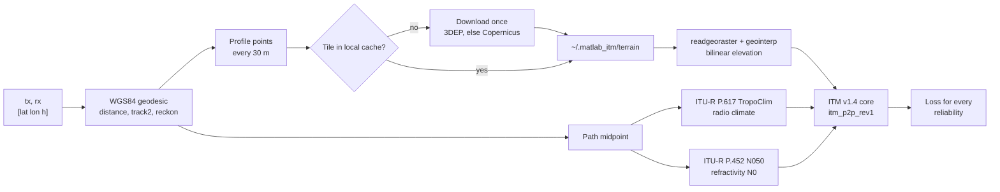

# matlab_itm

A MATLAB port of the NTIA/ITS Irregular Terrain Model (ITM, Longley-Rice)
version 1.4, point-to-point mode, with automatic terrain, radio climate, and
refractivity. It runs in MATLAB R2025b and in apps compiled with MATLAB
Compiler for the free MATLAB Runtime.

The core is a line-by-line port of the C++ reference implementation at
[NTIA/itm](https://github.com/NTIA/itm) (commit `183ad95`). It matches that
code to within 4 × 10⁻¹³ dB on 740 test cases, with identical propagation
modes, warning flags, and intermediate values.

## Quick start

```matlab
addpath('matlab_itm')

tx = [38.8895, -77.0353, 30];        % [lat (deg), lon (deg), height above ground (m)]
rx = [39.0458, -76.6413, 10];
reliability = [1 10 50 90 99];       % time percentages

loss_db = itm_pathloss_rev1(tx, rx, 2700, reliability)
% loss_db = 178.61  181.90  184.56  186.89  188.79
```

That's all you need to pass. The function finds the terrain profile, the
radio climate, and the surface refractivity for the path, and evaluates
every reliability from one geometry pass.

Many transmitters to one receiver, in one call:

```matlab
txs = [38.90 -77.03 30; 38.95 -76.90 25; 39.20 -76.70 40];
L = itm_pathloss_rev1(txs, rx, 2700, reliability);    % 3-by-5
```

A reliability-by-confidence table:

```matlab
T = itm_pathloss_rev1(tx, rx, 2700, [10; 50; 90], confidence=[10 50 90]);   % 3-by-3
```

## Functions

| Function | Purpose |
| --- | --- |
| `itm_pathloss_rev1(tx, rx, f_mhz, reliability)` | Path loss between locations, with everything automatic. Accepts N links. |
| `itm_p2p_rev1(h_tx_m, h_rx_m, pfl, f_mhz, reliability)` | ITM core for a terrain profile you supply. Equivalent to NTIA `ITM_P2P_CR` (and `ITM_P2P_TLS` with the `location` option). |
| `itm_terrain_profile_rev1(lat1, lon1, lat2, lon2)` | ITM PFL profile(s) along the WGS84 geodesic. |
| `itm_terrain_elevation_rev1(lat, lon)` | Terrain elevation at points, from cached 1 arc-second tiles. |
| `itm_radio_climate_rev1(lat, lon)` | ITU-R P.617 radio climate code (1–7). |
| `itm_surface_refractivity_rev1(lat, lon)` | ITU-R P.452 sea-level refractivity N₀. |
| `itm_download_tiles_rev1(lat_lim, lon_lim)` | Pre-fill the terrain cache for an area (offline servers). |
| `itm_cli_rev1(...)` | Command-line entry point for a compiled app. |
| `build_itm_app_rev1()` | Compiles `itm_cli_rev1` with MATLAB Compiler. |

Every function documents its inputs and name-value options; run
`help itm_pathloss_rev1`.

## How a call flows



## Terrain data

The terrain source has to work in a compiled app, without a MATLAB license
or an account. Both sources here are public, keyless, and served as plain
GeoTIFF files over HTTPS, so the app needs only `websave` and
`readgeoraster`. Both functions are supported by MATLAB Compiler.

| Source | Coverage | Resolution | Surface | Vertical datum | Tile size |
| --- | --- | --- | --- | --- | --- |
| [USGS 3DEP 1 arc-second](https://www.usgs.gov/3d-elevation-program) (default) | U.S. (CONUS, Alaska, Hawaii), Puerto Rico, U.S. Virgin Islands, Guam, border areas of Canada and Mexico | ~30 m | Bare earth | NAVD88 | ~45 MB per 1° × 1° |
| [Copernicus GLO-30](https://registry.opendata.aws/copernicus-dem/) (fallback) | Global | ~30 m | Surface model (includes buildings and canopy) | EGM2008 | ~35 MB per 1° × 1° |

With `terrain_source="auto"` (the default), each point comes from 3DEP.
Points where 3DEP has no tile or no data (outside the U.S., past a border,
offshore) are filled from Copernicus. Points with no data in either source,
such as open ocean, are set to 0 m. `info.profile.source_code` records the
source of every point.

Tiles download the first time a path needs them and are reused afterward:

- **Cache folder.** The `MATLAB_ITM_TERRAIN_DIR` environment variable, else
  `%LOCALAPPDATA%\matlab_itm\terrain` on Windows, else
  `~/.matlab_itm/terrain`. Override per call with `terrain_dir`.
- **Memory.** The eight most recently used tiles stay in memory (about
  52 MB each), so repeated calls in one area take tens of milliseconds.
- **Offline servers.** Run `itm_download_tiles_rev1` on a connected machine,
  copy the folder, and call with `download=false`. A missing tile then
  raises `itm:terrain:TileMissing` rather than failing silently.
- **Shared folders.** Downloads go to a temporary file and are renamed into
  place atomically (first writer wins), so several compiled servers can
  share one cache. The test suite checks this with two parallel workers.
- **Ocean tiles.** A tile the provider doesn't have is remembered with a
  zero-byte `.404` marker, so it isn't requested again.

Rough download sizes: a 100 km radius around one site is about 9 tiles
(400 MB); all of CONUS 3DEP is about 1,000 tiles (45 GB).

## Climate and refractivity

Both come from ITU-R data files bundled in `data/` and packaged into
compiled apps (see [data/SOURCES.md](data/SOURCES.md)).

- **Radio climate:** ITU-R P.617-3 radio-climatic zone map (`TropoClim.txt`,
  0.5° grid), nearest grid point, at the path midpoint. If the midpoint is
  over sea (code 7), the lower of the two terminal climates is used.
- **Refractivity:** ITU-R P.452 sea-level surface refractivity (`N050.TXT`,
  1.5° grid), bilinear interpolation, at the path midpoint. ITM converts N₀
  to the surface value Nₛ with the profile's mean terrain height.

These rules and the parameter defaults below follow the WInnForum CBRS SAS
reference model (`tropoclim.py`, `refractivity.py`, `wf_itm.py`). The
lookups reproduce that code exactly on 309 global test points.

Note: the ITU-R P.617 map puts Washington, DC, in climate 6 (maritime
temperate over land), not 5 (continental temperate).

## Defaults

| Parameter | Default | Option |
| --- | --- | --- |
| Confidence | 50 % | `confidence` |
| Polarization | Vertical | `polarization` |
| Relative permittivity | 25 | `epsilon` |
| Conductivity | 0.02 S/m | `sigma` |
| Mode of variability | 13 (broadcast, no location variability) | `mdvar` |
| Profile spacing | 30 m (native DEM resolution) | `spacing_m` |
| Profile point cap | None (WInnForum uses 1501) | `max_points` |

Reliability and confidence are percentages (0 to 100, exclusive), as in the
NTIA code. The WInnForum Python wrapper uses fractions (0 to 1).

## Vectorization

- **Reliability and confidence.** The link geometry (horizons, effective
  heights, terrain irregularity, reference attenuation) is computed once.
  Only the variability step runs per percentage, as array math with
  implicit expansion. 1,000 reliabilities cost about the same as one.
- **Terrain.** Horizon search, least-squares fits, and elevation sampling
  are vectorized. Elevations for all links in a call are sampled in one pass
  over the tiles.
- **Lookups.** Climate and refractivity accept arrays of points.
- **Floating point.** Where the C++ accumulates by repeated addition and then
  truncates to an integer index, the MATLAB uses `cumsum`, which adds in the
  same order. A `k*xi` form rounds differently and changed 22 of 740 results
  by up to 0.44 dB in testing.
- **One remaining loop.** The terrain-irregularity resampling keeps a loop of
  at most 245 steps: each step's rounding depends on the previous position,
  so it can't be expressed as an array operation without changing results.

## Compile for MATLAB Runtime

```matlab
build_itm_app_rev1()          % writes build/itm_cli(.exe or .app)
```

Then, on a machine with the R2025b MATLAB Runtime:

```text
itm_cli 38.8895 -77.0353 30 39.0458 -76.6413 10 2700 1,10,50,90,99
```

Required products: MATLAB and Mapping Toolbox. The build packages `data/`
and `private/`. To compile these functions into your own app, add the
`itm_*_rev1.m` files, the `private` folder, and the `data` folder.

This was tested on macOS: the compiled app ran outside MATLAB, downloaded
its tiles into an empty cache, and returned results identical to the MATLAB
session.

## Tests

```matlab
runtests('tests')                                         % all

% Skip the tests that download tiles
import matlab.unittest.selectors.HasTag
suite = testsuite('tests');
run(suite.selectIf(~HasTag('Network')))
```

The concurrent-download test needs a parallel pool (`parpool(2)`); without
one, it's reported as incomplete rather than failed.

| Test file | What it checks |
| --- | --- |
| `test_itm_p2p_rev1.m` | NTIA's published example and reliability-by-confidence table; NTIA `p2p.csv` cases; 740 randomized cases against the NTIA C++ (loss to 10⁻⁹ dB; modes, warnings, and intermediate values); vector vs scalar calls; output shapes; monotonic loss vs reliability; free-space check; every error identifier; warning flags. |
| `test_itm_geo_rev1.m` | Climate and refractivity vs WInnForum; vectorized lookups; wrapper vs core; N-link vs single-link calls; offline errors; 3DEP profile; Copernicus fallback and ocean; batched profiles; end-to-end loss; two workers downloading into one folder. |

The randomized cases come from the NTIA C++ itself. To regenerate them,
see [tests/reference/generator/README.md](tests/reference/generator/README.md).

## Errors and warnings

Errors use identifiers such as `itm:InvalidReliability` and quote the NTIA
error code (for example 1007). ITM warnings don't stop the run:
`info.warnings` holds the NTIA bitmask for every output element, and
`info.warning_messages` lists them in words.

## References

- NTIA/ITS, [ITM C++ source, v1.4](https://github.com/NTIA/itm)
- G.A. Hufford, A.G. Longley, W.A. Kissick, [A Guide to the Use of the ITS Irregular Terrain Model in the Area Prediction Mode](https://its.ntia.gov/publications/download/82-100_ocr.pdf), NTIA Report 82-100, 1982
- [Recommendation ITU-R P.617](https://www.itu.int/rec/R-REC-P.617), Propagation prediction techniques and data required for the design of trans-horizon radio-relay systems
- [Recommendation ITU-R P.452](https://www.itu.int/rec/R-REC-P.452), Prediction procedure for the evaluation of interference between stations on the surface of the Earth
- Wireless Innovation Forum, [Spectrum Access System reference models](https://github.com/Wireless-Innovation-Forum/Spectrum-Access-System)
